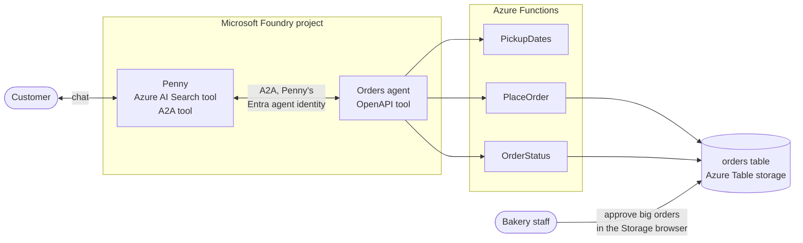

# Multiple AI agents on Azure: agent-to-agent (A2A) in Microsoft Foundry

**Give your AI agent a teammate.** Sample files for part 3 of the Blue Penguin Bakery series on
the Infra2AI YouTube channel, where we build **Penny**, an AI assistant for a fictional bakery,
in Microsoft Foundry.

**Watch:** [the series on YouTube](https://www.youtube.com/playlist?list=PLUKvmDqPth-M) ·
**Part 1:** [video](https://www.youtube.com/watch?v=5beCrJJskUk) · [code](https://github.com/infra2ai/first-ai-agent) ·
**Part 2:** [code](https://github.com/infra2ai/rag-on-azure)

## The story so far

In [part 1](https://github.com/infra2ai/first-ai-agent) we built Penny in Microsoft Foundry, with
tools and the bakery's own order API. In [part 2](https://github.com/infra2ai/rag-on-azure) she
got Azure AI Search, so she answers from all 32 of the bakery's documents.

Now customers want to *order*: custom cakes and catering. Orders come with rules (custom cakes
need 5 days' notice and are for up to 15 people; catering needs 3 working days and 20 people or
more), and every order has to go into the bakery's order system. Instead of giving all of that to
Penny, we give her a teammate:

- an **order system**: an orders table in Azure Table storage, and a `PlaceOrder` function that
  checks the bakery's rules in code, and holds orders for more than 30 people for staff approval
- an **Orders agent**: a second Foundry agent whose only job is orders, with the order API as its
  only tool
- **A2A**: Penny calls the Orders agent with the agent-to-agent protocol, signed in with her own
  Microsoft Entra agent identity

## The series

| Part | Video | What Penny learns | Code |
|---|---|---|---|
| 1 | [Build your first AI agent on Azure](https://www.youtube.com/watch?v=5beCrJJskUk) | Answers from files, analyses data with code, calls the bakery's order API, guardrails, tracing, and her own website | [infra2ai/first-ai-agent](https://github.com/infra2ai/first-ai-agent) |
| 2 | Azure AI Search for AI agents | Searches all of the bakery's documents, always up to date | [infra2ai/rag-on-azure](https://github.com/infra2ai/rag-on-azure) |
| 3 | Multiple AI agents: A2A in Microsoft Foundry | Hands every order to a teammate, the Orders agent | This repository |
| 4 | Coming next: the kitchen reacts to orders | Confirmed orders go on a queue; a Kitchen agent plans the baking and emails the supplier | |

All videos are in the [series playlist](https://www.youtube.com/playlist?list=PLUKvmDqPth-M).

## How it works



1. A customer asks Penny for a cake or catering. Penny never takes orders herself: she calls the
   **Orders agent** through her **A2A tool**, and passes on everything the customer told her
   ([Connect to an A2A agent endpoint](https://learn.microsoft.com/en-us/azure/foundry/agents/how-to/tools/agent-to-agent)).
2. The Orders agent publishes an **agent card** (what it can do, and its A2A address), and only
   accepts callers that have the **Foundry Agent Consumer** role
   ([Enable incoming A2A](https://learn.microsoft.com/en-us/azure/foundry/agents/how-to/enable-agent-to-agent-endpoint)).
   Penny signs in with her own **Entra agent identity**
   ([Agent identity](https://learn.microsoft.com/en-us/azure/foundry/agents/concepts/agent-identity)).
3. The Orders agent checks the pickup dates, then places the order through the order API. The
   functions read and write the **orders table** through bindings, without any database code
   ([Azure Tables bindings](https://learn.microsoft.com/en-us/azure/azure-functions/functions-bindings-storage-table)).
4. Orders for more than 30 people get the status *Waiting for staff approval*. A member of staff
   approves them by editing the order in the table.

## What is in this repository

| Path | Contents | Used in the video for |
|---|---|---|
| [`function/PlaceOrder/`](function/PlaceOrder) | The new function: checks the rules, gives the order the next number, writes it to the table | The order system |
| [`function/OrderStatus/`](function/OrderStatus) | Part 1's function, now reading the orders table | Set up before the video |
| [`function/PickupDates/`](function/PickupDates) | Lists the next pickup dates, so an agent can turn "Saturday" into a date | Set up before the video |
| [`function/host.json`](function/host.json) | The Function App's settings, with the extension bundle the table bindings need | |
| [`openapi/bakery-orders.json`](openapi/bakery-orders.json) | OpenAPI description of the order API: get pickup dates, place order, get order status | The Orders agent's tool |
| [`agents/orders-instructions.txt`](agents/orders-instructions.txt) | The Orders agent's instructions | Creating the Orders agent |
| [`agents/orders-agent-card.txt`](agents/orders-agent-card.txt) | The text for its agent card | Turning on A2A |
| [`agents/penny-instructions.txt`](agents/penny-instructions.txt) | Penny's instructions, with the new paragraph about orders | Giving Penny the Orders agent |

Blue Penguin Bakery is fictional, and so are its customers and orders.

## What you need

- **Everything from parts 1 and 2**: the Foundry resource and project with `gpt-4.1-mini`, Penny
  with her Azure AI Search tool, and a Function App (Consumption plan on Windows, Node.js) with
  `OrderStatus`. If you don't have them yet, follow
  [part 1](https://github.com/infra2ai/first-ai-agent#step-by-step) and
  [part 2](https://github.com/infra2ai/rag-on-azure#step-by-step).
- **Roles**: Foundry User on the Foundry resource, and permission to assign roles on it (for
  example Owner, or Role Based Access Control Administrator) for the permission step.

The video uses Switzerland North. A2A, Azure AI Search and OpenAPI tools are available there with
`gpt-4.1-mini`; see
[tool support by region and model](https://learn.microsoft.com/en-us/azure/foundry/agents/concepts/limits-quotas-regions#tool-support-by-region-and-model).

## What it costs

- **gpt-4.1-mini**: billed per token. An A2A call is a second agent run, so a team uses a little
  more than a single agent: a few cents for the whole video.
- **Azure Functions and Table storage**: a few cents.
- **Azure AI Search, Basic** (from part 2): about 0.10 USD an hour for as long as it exists.

Delete the resource group when you're done (see [Clean up](#clean-up)).

## Step by step

1. **The orders table.** Open the Function App's storage account, then **Storage browser >
   Tables > Add table**, and name it `orders`.
2. **The order API.** Replace `OrderStatus` with [`function/OrderStatus`](function/OrderStatus),
   and add `PickupDates` the same way. Then, on the Function App, click **Create**, choose
   **HTTP trigger**, name it `PlaceOrder`, and set the authorization level to *Anonymous*. Paste
   [`function.json`](function/PlaceOrder/function.json) (open it with the file picker above the
   code) and [`index.js`](function/PlaceOrder/index.js), and save both. Test it with
   **Test/Run**, method POST, and a body like:

   ```json
   { "customerName": "Anna Meier", "orderType": "cake", "item": "Chocolate cake with Happy birthday Mia", "people": 8, "pickupDate": "<a Saturday at least 5 days ahead, YYYY-MM-DD>" }
   ```
3. **The Orders agent.** In Foundry: **New agent > Build an agent**, name it `orders`, remove the
   default *Web search* tool, and paste
   [`orders-instructions.txt`](agents/orders-instructions.txt). Add the order API as a tool:
   **Add > Add tools > Custom > OpenAPI tool**, name it `bakery_orders`, and paste
   [`bakery-orders.json`](openapi/bakery-orders.json) with `servers.url` set to
   `https://<your Function App's Default domain>/api`. Save, and test it on its own: *Which days
   could I pick up a custom cake?*
   ([OpenAPI tool](https://learn.microsoft.com/en-us/azure/foundry/agents/how-to/tools/openapi))
4. **The agent card.** On the Orders agent's **Details** tab, under *A2A protocol*, click **Set
   up**, fill in the card from [`orders-agent-card.txt`](agents/orders-agent-card.txt), and
   **Save**. Copy the A2A endpoint that appears.
5. **Penny's A2A tool.** On Penny: **Add > Add tools > Custom > Agent2agent (A2A) > Create**. Name
   the connection `orders-agent`, paste the endpoint, keep *Microsoft Entra Agent Identity*, and
   **Connect**. Replace her instructions with
   [`penny-instructions.txt`](agents/penny-instructions.txt), and **Save**.
6. **Permission.** On Penny's **Details** tab, copy her *Entra agent identity* ID. In the Azure
   portal, on the Foundry resource: **Access control (IAM) > Add role assignment**, choose
   **Foundry Agent Consumer**, then **Select members**, paste the ID, **Select**, and **Review +
   assign**
   ([Foundry roles](https://learn.microsoft.com/en-us/azure/foundry/concepts/rbac-foundry)).
7. **Try it.** Ask Penny: *I'd like to order a chocolate cake with Happy birthday Mia on it, for 8
   people, to pick up on Saturday. My name is Lena Huber.* Then, in a new chat: *We'd like to
   order lunch platters for 40 people, for our team event on Thursday next week. It's for
   Helvetia Software, and my name is Max Keller.* The second order waits for staff approval.
8. **Approve it.** In the Storage browser, open the `orders` table, open the order's **⋯** menu,
   **Edit**, change *Status* to `Confirmed`, and **Update**. Ask Penny about the order again.
9. **Watch it in the traces.** Penny's run shows the A2A call to the Orders agent; the Orders
   agent's own run shows its call to the order API, and the message Penny sent it
   ([Tracing](https://learn.microsoft.com/en-us/azure/foundry/observability/how-to/trace-agent-setup)).

## Troubleshooting

| What you see | What to do |
|---|---|
| *Failed to fetch agent card ... not accessible to the configured identity* | Penny's agent identity needs the **Foundry Agent Consumer** role (step 6). A new role can take a minute to apply. |
| Penny collects the order details herself instead of calling the Orders agent | Check that her instructions include the paragraph from [`penny-instructions.txt`](agents/penny-instructions.txt), and that you saved. |
| The Orders agent keeps asking questions, or asks to confirm | Use the instructions from this repository: they say to use the first matching date, and not to ask about optional details. |
| `PlaceOrder` answers *We can't have this ready on ...* | The date isn't one the bakery can manage. Ask for `PickupDates` first; the Orders agent does this by itself. |
| Test/Run shows *Error while loading* | The Function App's CORS settings must allow `https://portal.azure.com`. Apps created in the portal allow it by default. |
| You named the function, but it was created as *HttpTrigger1* | Wait until the template's details form has fully loaded before typing the name. |

## Before you use this for real

- **Least privilege.** The portal assigns the role on the whole Foundry resource. With the Azure
  CLI, give Penny the role for the Orders agent alone:

  ```bash
  az role assignment create \
    --assignee-object-id "<Penny's Entra agent identity ID>" \
    --assignee-principal-type ServicePrincipal \
    --role "Foundry Agent Consumer" \
    --scope "/subscriptions/<subscription-id>/resourceGroups/<resource-group>/providers/Microsoft.CognitiveServices/accounts/<foundry-resource>/projects/<project>/agents/orders"
  ```
- **Protect the order API.** It still allows anonymous calls. Use a function key in an API key
  connection, or Microsoft Entra ID with the project's managed identity
  ([OpenAPI tool authentication](https://learn.microsoft.com/en-us/azure/foundry/agents/how-to/tools/openapi#choose-an-authentication-method)).
- **Let customers confirm before an order is placed.** Across agents this needs care: every A2A
  call starts fresh, so the confirmed details have to be passed along each time. In our tests,
  confirming through two agents was unreliable, which is why this sample places the order in one
  step.
- **Test each agent with evaluations,** and then the team together
  ([Evaluate agents](https://learn.microsoft.com/en-us/azure/foundry/observability/how-to/evaluate-agent)).

## Clean up

Delete the resource group to remove everything from parts 1 to 3. If you go on to part 4, keep
it. Agent identities live in Microsoft Entra ID, not in the resource group, and some can stay
behind; look for entries named after your Foundry resource, and delete them too. A deleted Foundry
resource is kept for 48 hours; purge it to reuse the name sooner
([Recover or purge deleted Foundry resources](https://learn.microsoft.com/en-us/azure/ai-services/recover-purge-resources)).

## Learn more

- [Connect to an A2A agent endpoint](https://learn.microsoft.com/en-us/azure/foundry/agents/how-to/tools/agent-to-agent)
  and [enable incoming A2A on a Foundry agent](https://learn.microsoft.com/en-us/azure/foundry/agents/how-to/enable-agent-to-agent-endpoint)
- [Agent identity](https://learn.microsoft.com/en-us/azure/foundry/agents/concepts/agent-identity)
  and [Foundry roles](https://learn.microsoft.com/en-us/azure/foundry/concepts/rbac-foundry)
- [Configure and share your agent](https://learn.microsoft.com/en-us/azure/foundry/agents/how-to/configure-agent):
  endpoints, protocols and authorization
- [Azure Tables bindings for Azure Functions](https://learn.microsoft.com/en-us/azure/azure-functions/functions-bindings-storage-table)
  and [Azure Table storage](https://learn.microsoft.com/en-us/azure/storage/tables/table-storage-overview)
- Why not Foundry workflows? Microsoft is retiring them on 1 December 2026, and recommends
  Microsoft Agent Framework for new multi-agent workflows
  ([Build a workflow in Microsoft Foundry](https://learn.microsoft.com/en-us/azure/foundry/agents/concepts/workflow)).

## Next

In part 4, the kitchen reacts to orders: every confirmed order goes onto a queue, and a Kitchen
agent plans the baking, checks the stock, and emails the supplier when an ingredient runs low.
Follow the [series playlist](https://www.youtube.com/playlist?list=PLUKvmDqPth-M) so you don't
miss it.
